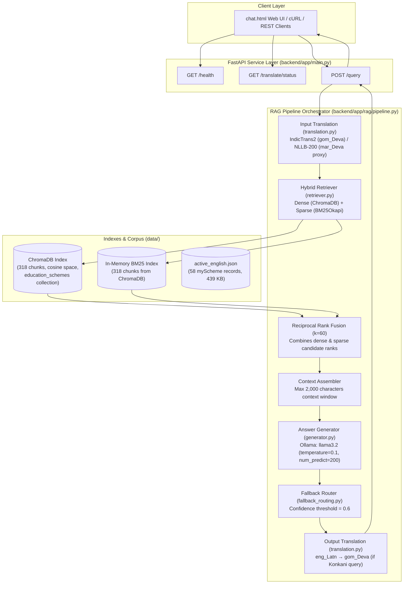
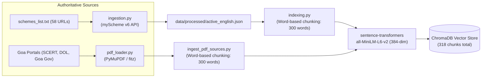

# Architecture

> **Research baseline:** [RESEARCH_PLAN.md](file:///c:/Users/athar/coding/model%20review/A%20Multilingual%20Retrieval-Augmented%20AI%20Assistant%20for%20Government%20Services/docs/RESEARCH_PLAN.md) defines the core design: Goan Konkani (Devanagari script) and English input/output over an authoritative English active retrieval corpus. This document specifies the active architecture implemented and running across the repository.

---

## System Overview

The system implements an end-to-end, privacy-preserving, CPU-executable Multilingual RAG pipeline tailored for citizen queries regarding educational schemes and public welfare programs in Goa and India.

---

## Offline Knowledge-Base Preparation

The knowledge base is constructed from two authoritative sources:
1. **myScheme.gov.in Public API:** Ingestion tool (`backend/app/services/ingestion.py`) reads the maintained scheme register [`schemes_list.txt`](file:///c:/Users/athar/coding/model%20review/A%20Multilingual%20Retrieval-Augmented%20AI%20Assistant%20for%20Government%20Services/schemes_list.txt), fetches cleaned English documents, and outputs `data/processed/active_english.json`.
2. **Goa Government PDF Portals:** PDF loader (`backend/app/ingestion/pdf_loader.py`) fetches circulars, charters, and scholarship guidelines from SCERT Goa, the Directorate of Official Language Goa (DOL Goa), Tribal Welfare, and the South Goa Collectorate using PyMuPDF (`fitz`).

### Corpus Composition (Verified in Runtime)
| Source Family | Description | Documents | Chunks |
|---|---|---|---|
| **myScheme** | Central & state educational/internship schemes | 58 | 203 |
| **DOL_Goa** | Directorate of Official Language Goa charters & schemes | 3 | 16 |
| **Goa_Gov** | Tribal Welfare & South Goa Collectorate charters | 2 | 90 |
| **SCERT_Goa** | Science Talent Search, NMMSS & state scholarships | 5 | 9 |
| **Total** | **Authoritative active knowledge base** | **68** | **318** |

---

## Logical Components (As Built)

| Component | Module | Implementation Details |
|---|---|---|
| **Web UI** | [`chat.html`](file:///c:/Users/athar/coding/model%20review/A%20Multilingual%20Retrieval-Augmented%20AI%20Assistant%20for%20Government%20Services/chat.html) | Vanilla HTML/CSS/JavaScript single-page app with language toggling, suggested prompts, citation links, and confidence badges. |
| **API Framework** | [`app/main.py`](file:///c:/Users/athar/coding/model%20review/A%20Multilingual%20Retrieval-Augmented%20AI%20Assistant%20for%20Government%20Services/backend/app/main.py) | FastAPI with lazy model loading, asynchronous request offloading (`asyncio.to_thread`), and CORS support. |
| **Hybrid Retriever** | [`app/rag/retriever.py`](file:///c:/Users/athar/coding/model%20review/A%20Multilingual%20Retrieval-Augmented%20AI%20Assistant%20for%20Government%20Services/backend/app/rag/retriever.py) | Dense vector search via ChromaDB + sparse keyword search via `BM25Okapi` over all 318 indexed chunks. |
| **Rank Fusion** | [`app/rag/retriever.py`](file:///c:/Users/athar/coding/model%20review/A%20Multilingual%20Retrieval-Augmented%20AI%20Assistant%20for%20Government%20Services/backend/app/rag/retriever.py#L21-L52) | Reciprocal Rank Fusion (RRF) with constant $k=60$. Deduplicates content based on 300-character prefixes. |
| **Translation Layer** | [`app/rag/translation.py`](file:///c:/Users/athar/coding/model%20review/A%20Multilingual%20Retrieval-Augmented%20AI%20Assistant%20for%20Government%20Services/backend/app/rag/translation.py) | Multi-tier strategy: 1) AI4Bharat IndicTrans2 200M (`gom_Deva`), 2) Meta NLLB-200 600M (`mar_Deva` proxy), 3) passthrough fallback. |
| **Answer Generator** | [`app/rag/generator.py`](file:///c:/Users/athar/coding/model%20review/A%20Multilingual%20Retrieval-Augmented%20AI%20Assistant%20for%20Government%20Services/backend/app/rag/generator.py) | Ollama LLM integration (`llama3.2`), constrained with low temperature (`0.1`), max 200 output tokens, and 2,000 char prompt limit. |
| **Fallback Router** | [`app/rag/fallback_routing.py`](file:///c:/Users/athar/coding/model%20review/A%20Multilingual%20Retrieval-Augmented%20AI%20Assistant%20for%20Government%20Services/backend/app/rag/fallback_routing.py) | Normalizes average RRF scores to $[0, 1]$; flags route as `"fallback"` and appends official portal verification caveat if score $< 0.6$. |
| **Vector Store** | ChromaDB | Persistent local SQLite/hnsw index at `data/indexes/chroma/`, collection `education_schemes` with cosine similarity. |
| **Document Ingestion** | [`app/services/ingestion.py`](file:///c:/Users/athar/coding/model%20review/A%20Multilingual%20Retrieval-Augmented%20AI%20Assistant%20for%20Government%20Services/backend/app/services/ingestion.py) & [`pdf_loader.py`](file:///c:/Users/athar/coding/model%20review/A%20Multilingual%20Retrieval-Augmented%20AI%20Assistant%20for%20Government%20Services/backend/app/ingestion/pdf_loader.py) | Robust REST client with retry logic for myScheme v6 public API and PyMuPDF text cleaner for Goa government PDF circulars. |

---

## Hardware & Deployment Profile

- **Inference Footprint:** Fully operable on standard developer workstations without a dedicated GPU.
  - LLM: `llama3.2` running on CPU via Ollama (typically 20–40 seconds per query on CPU).
  - Embeddings: `all-MiniLM-L6-v2` (384-dimensional, fast CPU inference < 50ms).
  - Translation: IndicTrans2 or NLLB-200 running on CPU PyTorch.
- **Production Extension:** Environment variables allow swapping the embedding model to `BAAI/bge-m3` (1024-dim multilingual) and pointing `OLLAMA_URL` to a dedicated GPU-accelerated server.
