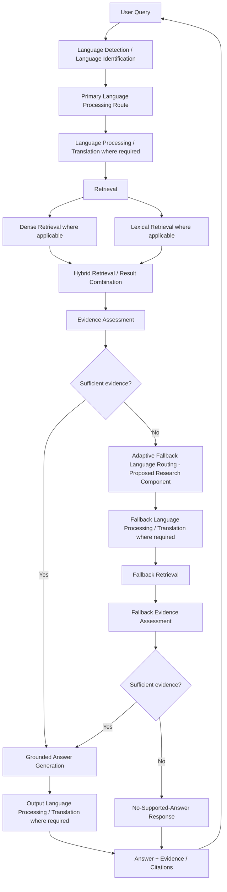
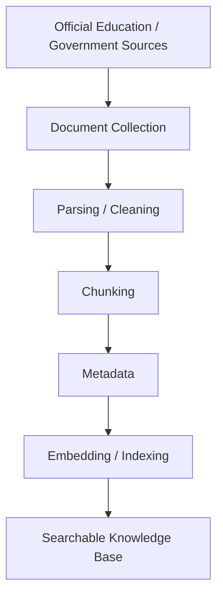

# Architecture

> **Research baseline:** The current route is Konkani (Devanagari) input/output over an English active corpus. Native Konkani/Marathi documents are translation-audit references, not indexed retrieval content. See [RESEARCH_PLAN.md](RESEARCH_PLAN.md).

## Status

This document describes the **proposed target architecture** for the repositioned Multilingual RAG research prototype. It does not claim that every component is implemented.

Existing repository evidence:

- Backend scaffold and dependencies indicate planned use of FastAPI, ChromaDB, LangChain, Ollama, sentence-transformers, rank-bm25, SQLAlchemy, and document-processing libraries.
- Docker Compose contains services for frontend, backend, ChromaDB, Ollama, embedding, Nginx, and persistent data volumes.
- Backend and frontend source modules are mostly placeholders.

## Target Online Query Flow

Notes:

- The diagram is the proposed target architecture.
- Exact language-processing technology is To be determined.
- Evidence/confidence threshold is To be determined experimentally.
- Fallback-language mapping is To be determined based on linguistic/resource criteria and experimental evaluation.
- Retrieval scores do not guarantee correctness.
- Retrieved evidence does not automatically guarantee factual correctness.
- Citations do not guarantee that every generated claim is supported.

## Offline Knowledge-Base Preparation

Planned corpus distinction:

- **Active retrieval corpus:** official or authoritative education-domain documents selected for indexing.
- **Translation / reference / audit material:** supporting material that may help language processing, evaluation, or review but is not automatically part of the retrieval index.

No repository evidence currently proves that a target education corpus has been collected or indexed.

## Logical Components

| Component | Status | Notes |
|---|---|---|
| Frontend chat/search UI | Scaffold / previous prototype planning | Existing frontend files are mostly placeholders plus one legacy English i18n file. |
| API layer | Scaffold / planned | Backend dependency configuration includes FastAPI, but endpoint modules are mostly placeholders. |
| Document ingestion | Planned | Data folders exist, but target corpus and ingestion code are not implemented. |
| Cleaning and chunking | Planned | Placeholder modules exist. Final rules for Konkani and education documents are To be determined. |
| Embedding and indexing | Planned / prototype technology named | Dependencies and Docker config include sentence-transformers and ChromaDB. Final model selection is To be determined. |
| Dense retrieval | Planned / prototype technology named | ChromaDB is present in dependencies and Docker config. |
| Lexical retrieval | Planned / prototype technology named | rank-bm25 dependency is present. |
| Hybrid retrieval | Proposed | Useful for combining semantic and lexical evidence where implemented. |
| Evidence assessment | Proposed | Required by target architecture; threshold To be determined experimentally. |
| Adaptive fallback routing | Proposed research component | Not implemented; mapping To be determined. |
| Grounded generation | Planned | Ollama and LangChain are present in dependency/config files, but final generation model is not finalized. |
| No-supported-answer behavior | Planned | Required to avoid unsupported answers. |

## Technology Classification

| Technology | Repository Evidence | Classification |
|---|---|---|
| FastAPI | `backend/pyproject.toml`; Docker healthcheck references API | Existing prototype dependency / planned API framework |
| React/Vite/Tailwind | README and Docker comments, but no package manifest found | Previous prototype plan; implementation not established |
| ChromaDB | dependency, Docker service, data folder | Existing prototype component in configuration; target use planned |
| rank-bm25 | dependency | Existing prototype dependency; target lexical retrieval proposed/planned |
| sentence-transformers | dependency | Existing prototype dependency; final embedding model To be determined |
| LangChain | dependency | Existing prototype dependency; final orchestration approach To be determined |
| Ollama / Llama 3.1 | dependency and Docker comment | Previous prototype configuration; final model To be determined |
| SQLite/PostgreSQL | dependency and Docker configuration | Existing prototype configuration; final persistence choice To be determined |

## Research Risks

Adaptive fallback routing may introduce additional latency, additional processing, cascading translation errors, semantic drift, and uncertain performance improvement. It must be evaluated rather than assumed beneficial.
